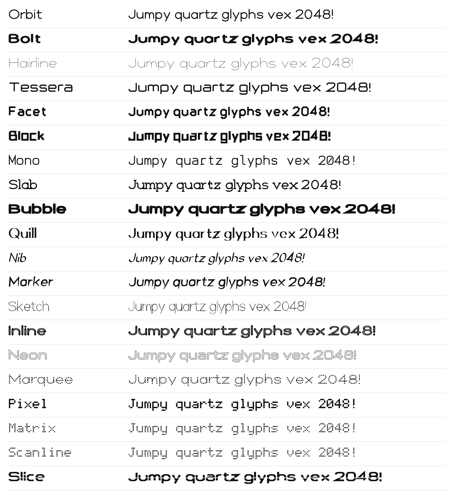

# Fonts pack

Fonts Vixl installs from this pinned archive instead of from Google Fonts: the twenty **Vixl Originals**, typefaces
drawn and built with Vixl ([`originals/`](originals/README.md)), and the third-party fonts the examples use.

| Family | Weight | Licence |
| --- | --- | --- |
| [Vixl Originals](originals/README.md) (Orbit, Bolt, Hairline, Tessera, Facet, Block, Mono, Slab, Bubble, Quill, Nib, Marker, Sketch, Inline, Neon, Marquee, Pixel, Matrix, Scanline, Slice) | one each, 100–900 | [SIL OFL 1.1](sources/OFL-vixl-originals.txt) |
| Press Start 2P | 400 | [SIL OFL 1.1](sources/OFL-press-start-2p.txt) |
| Space Mono | 400 | [SIL OFL 1.1](sources/OFL-space-mono.txt) |



Vixl's catalog lists the Originals with `"source": "vixl"`; `font install 'Vixl Orbit'` (or a pairing that uses one)
reads the face from this pack, downloading the archive once and checking its pinned SHA-256.

`fonts.zip` holds the `.ttf` files, their licences and `manifest.json`. The files are named the way Vixl's font cache
names them (`press-start-2p-400.ttf`), so unpacking the archive into `VIXL_FONT_CACHE` is all it takes for Vixl to use
them without a download.

Vixl's own fallback fonts (Noto and DejaVu) are not here: they ship inside the Vixl package so text renders offline.

## Use it

```python
import zipfile
from vixl import packs

with zipfile.ZipFile(packs.path("fonts")) as archive:   # downloads once, checks the pinned SHA-256
    archive.extractall("my-font-cache")                  # then set VIXL_FONT_CACHE=my-font-cache
```

## Update it

For the Vixl Originals, rebuild them ([`originals/README.md`](originals/README.md)); the builder updates
`manifest.json`. For a third-party font, put the font file in `sources/` with its licence, add it to `manifest.json`, run `python fonts/build_pack.py`, commit,
then update the `fonts` entry in `PACKS` in Vixl's `src/vixl/packs.py` (commit, sha256, bytes).
