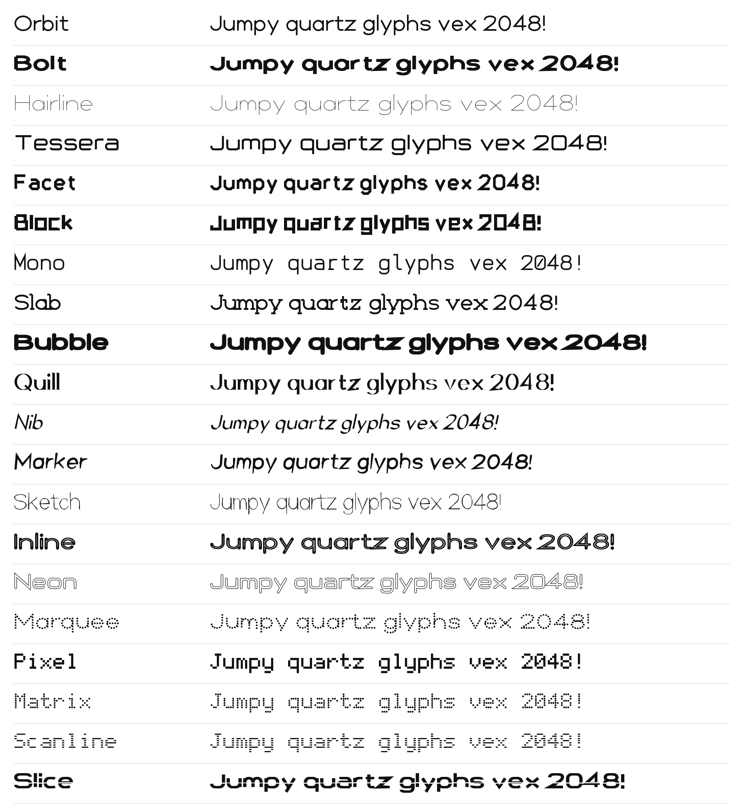

# Vixl Originals

Twenty original typefaces drawn and built with Vixl itself, under the SIL Open Font License 1.1
([`../sources/OFL-vixl-originals.txt`](../sources/OFL-vixl-originals.txt)). They ship in the `fonts` content pack, so
Vixl can install them by name (`font install 'Vixl Orbit'`, or a pairing that uses them) like any catalog family.



| Family | Weight | Style | Construction |
| --- | --- | --- | --- |
| Vixl Orbit | 400 | geometric sans | circles and straight lines, round terminals |
| Vixl Bolt | 800 | geometric black | flat cuts, slightly thinned horizontals |
| Vixl Hairline | 100 | wide hairline sans | 20-unit strokes, extended width |
| Vixl Tessera | 500 | squarish techno sans | rounded-square bowls, wide |
| Vixl Facet | 700 | condensed octagonal | chamfered corners |
| Vixl Block | 800 | condensed square | right-angled corners |
| Vixl Mono | 400 | monospaced | rounded corners, slab-footed narrow letters, slashed zero |
| Vixl Slab | 500 | geometric slab serif | automatic slab serifs and beaks |
| Vixl Bubble | 900 | fat rounded display | squircle bowls, round terminals |
| Vixl Quill | 400 | high-contrast serif | broad-nib stress at 0°, hairline serifs |
| Vixl Nib | 400 | calligraphic italic | broad-nib stress at 35°, 12° slant |
| Vixl Marker | 600 | hand-drawn marker | seeded jitter, tapered stroke ends |
| Vixl Sketch | 300 | pencil sketch | every line drawn twice, loosely |
| Vixl Inline | 800 | Art Deco inline | outline-stroke, pathfinder subtract of an inline channel |
| Vixl Neon | 400 | hollow tubes | outline-stroke, pathfinder subtract of the inner tube |
| Vixl Marquee | 500 | dotted bulbs | dotted dashes fitted to each stroke |
| Vixl Pixel | 400 | 5 x 7 pixel | square pixels, monospaced |
| Vixl Matrix | 400 | 5 x 7 dot matrix | round LED dots, monospaced |
| Vixl Scanline | 400 | 5 x 7 scanline | pixel rows as thin bars, monospaced |
| Vixl Slice | 800 | sliced rounded-square | pathfinder subtract of one horizontal cut |

Each covers printable ASCII (95 characters plus `.notdef` and the no-break space). Per-family specimens are in
[`specimens/`](specimens/).

## How they are made

[`skeletons.py`](skeletons.py) holds one hand-drawn centreline per character (polylines with *soft corners*, bowls and
bowl arcs) and a 5 x 9 bitmap set. [`build_originals.py`](build_originals.py) turns each family's settings into Vixl
operations: soft corners become circles, squircles, chamfers or square corners; strokes get the family's weight, caps,
joins, slant, jitter, tapers, broad-nib `width_profile` or dotted `dash`; slab serifs are added where straight strokes
end on a guide line. The hollow, inline and sliced families use `outline-stroke`, `path-simplify` and `pathfinder`.
The glyphs live in `font-grid` cells, are mapped with `font-glyph`, and are exported with Vixl's font maker.

The editable masters are in [`masters/`](masters/): open one in Vixl to change a glyph, then `export` it again, or
change the skeletons or a family's settings and rebuild.

## Rebuild

With Vixl installed (`pip install vixl`; a release that lists the Vixl Originals in its catalog, since earlier ones clip
outlined strokes to their old box), from the root of this repository:

```bash
python fonts/originals/build_originals.py           # every family, or name some: orbit quill
python fonts/originals/overview.py
python fonts/build_pack.py
```

The build is reproducible: the same Vixl version, skeletons and settings give byte-identical TTFs. It refuses a glyph
Vixl cannot merge into one outline, and reports any glyph it drew with a lighter stroke to make it merge. Then update
the `fonts` entry of `PACKS` in Vixl's `src/vixl/packs.py`.
